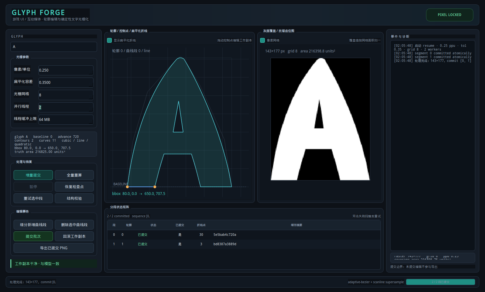

# Glyph Forge

面向游戏 UI 与互动媒体的字形轮廓编辑、确定性扁平化与抗锯齿光栅化桌面工作台。
项目包含本地样本生成器、核心算法、严格分段状态机、原子检查点/崩溃恢复、编辑事务、
三条处理路径的逐像素比对、CLI 验收工具和 PySide6 可视化界面。



## 已实现能力

- 读取量化整型轮廓 JSON，校验字段、闭合性、段类型、坐标范围和首尾连续性。
- 以像素/单位缩放和扁平化容差对二次/三次 Bézier 做自适应 de Casteljau 细分。
- 以可配置 `1..16` 子采样网格执行偶奇扫描线填充，输出灰度覆盖、逐像素计数、
  包围盒、覆盖面积与相对解析面积的误差。
- 每个轮廓是独立分段，严格按
  `待扁平化 → 已扁平化 → 已填充 → 已提交` 推进；异常段进入 `失败`，可重试。
- 每提交一段，原子写入折线点、覆盖位图分量、内容哈希、参数哈希与算法版本。
- 全量重算、实时增量提交、持久化断点恢复三条路径逐像素一致。
- 编辑只修改工作副本；提交批次原子写回模型，失败时模型与工作副本均回滚。
- 拖动控制点、细分新增曲线段、删除曲线段、修改容差/网格/并行度。
- 并行扁平化/填充，固定最大线程数、每线程缓冲上限与稳定提交序。
- 轮廓、控制点、扁平化折线、覆盖位图、状态矩阵、运行日志的专业暗色界面。

## 环境与启动

实际安装与验证环境（2026-11-23）：

| 组件 | 实际版本 |
|---|---|
| Python | 3.11.18 |
| pip | 26.3 |
| NumPy | 2.4.6 |
| PySide6 | 6.12.0 |
| pytest | 9.2.0 |

工作区已包含 `.venv`。从零复现：

```bash
uv python install 3.11
uv venv --python 3.11 .venv
uv pip install --python .venv/bin/python -r requirements.txt
.venv/bin/python -m ensurepip --upgrade
.venv/bin/python -m pip install -e .
```

不依赖 GPU、容器或远程服务。启动桌面进程：

```bash
.venv/bin/glyph-workbench gui
# 或
.venv/bin/python -m glyph_workbench.cli gui
```

界面首次启动会把只读样本复制为 `persist/runtime/glyph_model.json`，之后编辑与提交
作用于该运行模型，不静默改写 `samples/glyph_samples.json`。持久化目录为 `persist/`，
运行账户已通过读写探针验证。

## 本地样本

```bash
.venv/bin/glyph-workbench generate
```

生成结果：

- `samples/glyph_samples.json`：A/O/B 三个字形，多条闭合轮廓，混合直线、
  二次和三次 Bézier，包含基线、前进宽度、量化范围与嵌入式解析真值。
- `samples/glyph_truth.json`：独立解析真值文件，含精确包围盒、曲线积分面积、
  每条轮廓有向面积和曲线采样点。
- `samples/corrupt/*.json`：6 类损坏样本。
- `samples/manifest.json`：损坏样本与预期错误码映射。

样本坐标全部是整型，当前 `coordinate_quantum=1`，范围 `[-4096, 8192]`。
每个轮廓显式声明 `closed: true`，存储的折线点不重复写入首点，闭合边为隐式边，
因此同时满足“闭合”和“无重复端点”。

## 常用命令

```bash
# 结构校验 + 全部损坏样本错误码检查
.venv/bin/glyph-workbench validate

# 单字形光栅输出（PGM/NPZ/JSON/PNG）
.venv/bin/glyph-workbench render --glyph A --export artifacts/A_raster

# 三条路径逐像素比对（含一次真实子进程强制退出和恢复）
.venv/bin/glyph-workbench consistency --glyph B --workers 4

# 全部字形全量/增量一致性与面积验收
.venv/bin/glyph-workbench demo

# 环境、依赖与持久化权限
.venv/bin/glyph-workbench doctor
```

`consistency` 的实际流程：

1. 进程内一次性全量重算。
2. 增量路径提交 1 段后暂停，再从检查点恢复完成。
3. 子进程提交 1 段后 `os._exit(17)`，父进程重新加载持久化前缀并完成。
4. 比较位图尺寸、像素覆盖计数、提交序列；不一致时抛出 `E_DIFF` 并给出首个
   不一致像素、所属分段和阶段状态。

## 关键设计

### 扁平化

- 控制点先乘以 `pixels_per_unit`，在像素空间衡量控制点到弦的最大距离。
- 曲线在 `t=0.5` 递归二分，直到平坦度不超过容差或达到深度上限 24。
- 二分是单调细化：容差收紧时不会减少折线段数。
- 相邻重复点会被消除，首点不会在末尾重复写入。
- 与解析真值采样点的最近折线距离聚合为 `mean/rms/max/p95`。

### 光栅化

- 输出尺寸由解析曲线包围盒与缩放确定：
  `width=ceil((xmax-xmin)*ppu)`，高度同理。
- 每个像素拆为 `grid×grid` 个子单元，扫描线在每个子单元中心做偶奇填充。
- 每个轮廓保存打包后的子像素占用位和像素覆盖计数；最终字形按轮廓位图异或合并，
  与偶奇规则一致，也保证增量恢复和全量计算可逐位复现。
- 覆盖值 `count/grid²` 在 `[0,1]` 内；面积 `sum(count)/grid²/ppu²`。
- 网格越界、位图尺寸过大或单线程缓冲超过上限返回 `E_PARA`。

### 状态与检查点

合法迁移：

```text
PENDING_FLATTEN -> FLATTENED -> FILLED -> COMMITTED
        |              |          |
        +--------------+----------+-> FAILED -> PENDING_FLATTEN (retry)
```

非法迁移立即返回 `E_STATE`，内存状态保持原值。`COMMITTED` 为终态。

检查点身份由三部分组成：

- 字形内容 SHA-256（几何、基线、前进宽度、量化范围，不含真值缓存）。
- 参数 SHA-256（`pixels_per_unit`、`tolerance`、`grid`、算法标识）。
- 算法版本 `glyph-raster/1:adaptive-bezier+scanline-supersample`。

持久化写入顺序：

1. 段缓存写入同目录临时文件并 `fsync`。
2. `os.replace` 原子替换。
3. 原子更新 `manifest.json`，最后才出现该已提交段引用。
4. `states.json` 记录完整五态矩阵、提交序列和 `committed` 标志。

写入同时受线程锁和 `flock` 文件锁保护，所以跨线程、跨进程均不会交错。
恢复只接受从第 0 段开始连续的已提交前缀；任何哈希/版本/尺寸/覆盖计数异常都会
使整份快照失效并全量重算，不会混用旧段。

### 编辑事务

- 工作副本与已提交模型深拷贝隔离。
- 控制点拖动、细分、删除、参数变更都只修改工作副本。
- 提交前先完成结构校验与全部分段处理，再原子替换模型。
- 内容与包围盒未变化时复用未脏轮廓缓存，只重算依赖分段。
- 提交失败（含模型写盘失败）整批回滚，已提交段的覆盖值不会被静默改写。
- 导出始终读取已提交结果，未提交编辑不参与导出或一致性比对。

## 错误码

| 错误码 | 含义 |
|---|---|
| `E_SCHEMA` | 字段缺失、轮廓未闭合、连续性/量化范围错误 |
| `E_CURVE` | 无法识别的曲线段类型 |
| `E_DECODE` | JSON 无法解析或文件不可读 |
| `E_PARA` | 容差、网格、缩放、线程或缓冲参数越界 |
| `E_STATE` | 非法状态迁移、提交顺序或恢复前缀异常 |
| `E_DIFF` | 位图尺寸、像素覆盖或提交序列不一致 |
| `E_IO` | 模型/检查点持久化失败 |

CLI 将错误以 JSON 输出到 stderr，并使用非零退出码。

## 实际验收结果

### 自动化测试

```text
$ .venv/bin/python -m pytest -q
29 passed
```

覆盖：样本结构、6 类损坏错误码、容差单调性、闭合/去重、真值偏差、位图尺寸、
面积误差、网格/缓冲边界、五态迁移、原子检查点、硬崩溃恢复、参数/内容失效、
三路径逐像素一致、并行序稳定、首差异定位、单段失败隔离重试、编辑事务回滚、
CLI 子进程与界面离屏冒烟。

机器可读的本次验收记录见 `artifacts/verification.json`。

### 样本一致性

默认参数 `ppu=0.25, tolerance=0.35, grid=8`：

| 字形 | 位图 | 提交序 | 光栅面积 | 解析面积 | 相对误差 |
|---|---:|---|---:|---:|---:|
| A | 143×177 | `[0,1]` | 216398.75 | 216825.00 | 0.197% |
| O | 105×175 | `[0,1]` | 170949.00 | 170976.60 | 0.016% |
| B | 134×175 | `[0,1,2]` | 260677.00 | 260903.70 | 0.087% |

`glyph-workbench demo` 对三字形均报告 `pixel_exact: true`。

`glyph-workbench consistency --glyph B --workers 4` 实际结果：

```text
pixel_exact: true
commit_sequence: [0, 1, 2]
full_vs_live: equal
full_vs_resume: equal
live_loaded_from_checkpoint: 1
resume_loaded_from_checkpoint: 1
coverage_pixel_sha256: 65d79d5b7da4b2094fccc9feb0e862fecb28a4f84b8962a71b6e0c5f50a992e9
```

### 损坏样本

`glyph-workbench validate` 实际通过全部 6 项：

| 样本 | 结果 |
|---|---|
| `missing_field.json` | `E_SCHEMA` |
| `unclosed.json` | `E_SCHEMA` |
| `bad_curve_type.json` | `E_CURVE` |
| `discontinuous.json` | `E_SCHEMA` |
| `out_of_range.json` | `E_SCHEMA` |
| `malformed.json` | `E_DECODE` |

### 界面

已在 `QT_QPA_PLATFORM=offscreen` 下实际实例化、完成处理、编辑控制点、提交批次、
导出 PNG 和窗口截图。工作台自带 WenQuanYi Micro Hei 字体，不依赖系统中文环境。

## 项目结构

```text
glyph_workbench/
  models.py        # 数据模型、JSON 解析与结构校验
  geometry.py      # Bézier 采样、极值包围盒、解析面积、真值
  flatten.py       # 自适应细分与偏差统计
  raster.py        # 扫描线/子采样覆盖、位图合并与面积
  state.py         # 严格五态状态机
  checkpoint.py    # 原子检查点、版本校验、稳定前缀恢复
  engine.py        # 并行分段流水线、提交序与失败隔离
  session.py       # 工作副本、编辑操作与原子批次提交
  compare.py       # 首差异定位与 E_DIFF
  export.py        # PGM/NPZ/JSON/PNG 输出
  gui.py           # PySide6 工作台
  cli.py           # 命令行验收入口
  samplegen.py     # 确定性样本与损坏样本生成
  assets/fonts/    # 内置中文字体及许可证
tests/             # 29 项自动化测试
samples/           # 已生成样本、真值与损坏样本
persist/           # 本地检查点/运行模型目录
docs/workbench.png # 实际界面截图
```

## 边界约定

- 填充规则使用偶奇规则，适合常规字体外轮廓/内孔结构；重叠轮廓按奇偶覆盖合并。
- 坐标编辑按 `coordinate_quantum` 四舍五入。
- 默认每线程工作缓冲上限 64 MiB，最大位图边长 16384，最大像素数 64 MiB。
- 检查点格式当前为版本 1；算法或格式变更会使旧快照整体失效。
- 运行时不访问网络，不启动容器，不连接远程账号。
- 内置字体 WQY Micro Hei 的许可证见
  `glyph_workbench/assets/fonts/wqy-microhei.LICENSE`。
