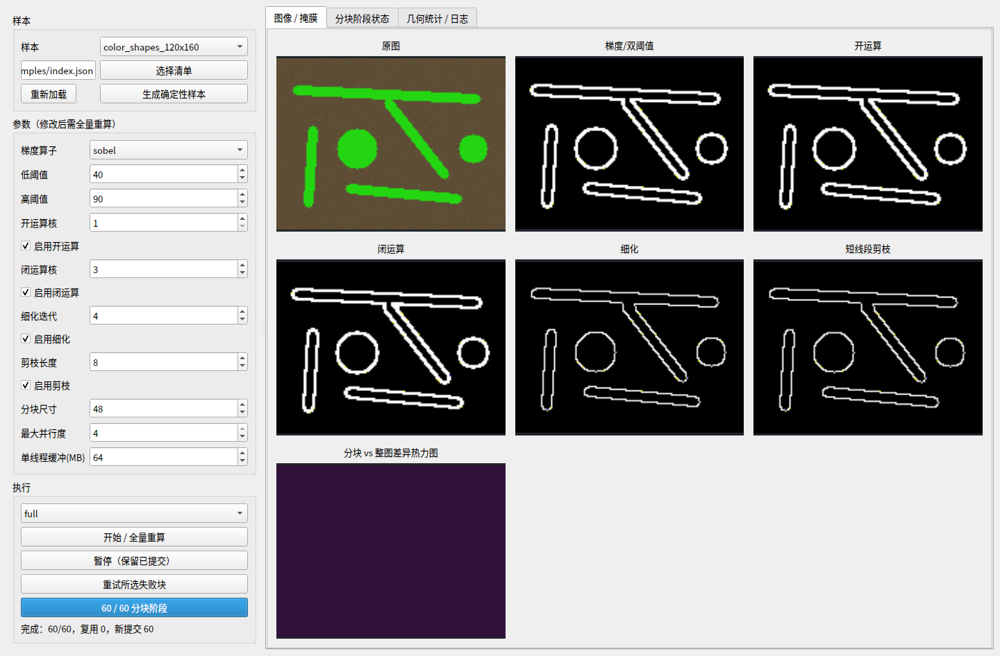
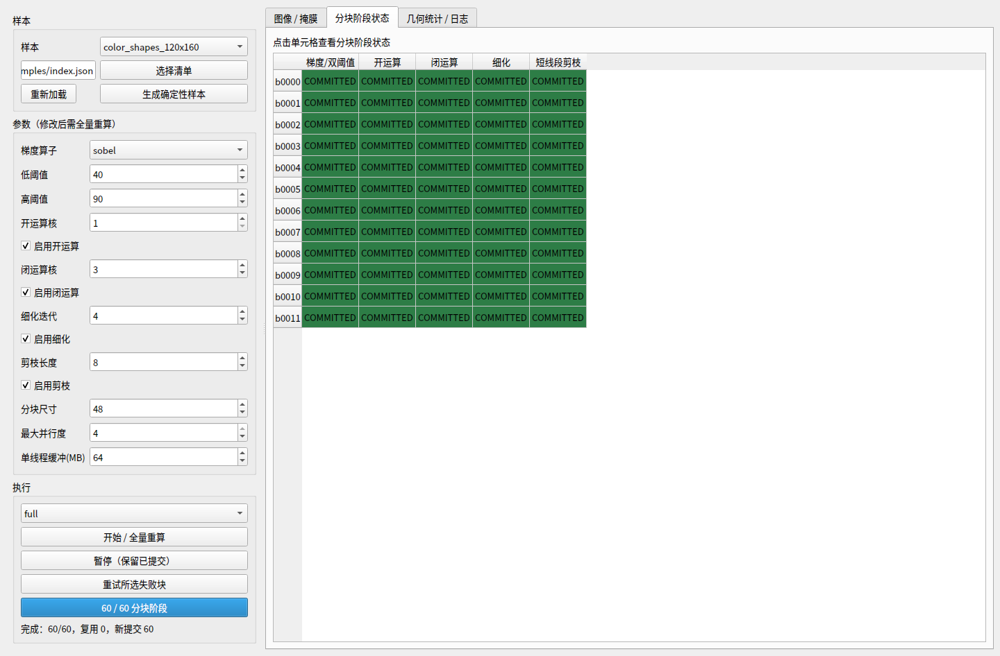

# EdgePipe：分块边缘检测、形态学处理与可恢复验证工具

EdgePipe 在本地对游戏/多媒体素材执行一条确定性的边缘与形态学管线：

`梯度 + 高低双阈值 → 开运算 → 闭运算 → 细化 → 短线段剪枝`

图像按固定尺寸分块、按阶段推进，每个“分块 × 阶段”结果都进入四态状态机并原子写入检查点。工具支持全量、增量与断点恢复三条运行路径，并提供逐像素差异定位、整图参考比对、PyQt5 诊断界面和 pytest 验收测试。

## 交付内容

- `src/edgepipe/`：参数、样本、五阶段算子、分块引擎、状态机、检查点、差异定位、几何真值统计、CLI 与 GUI。
- `samples/`：4 个固定种子 PNG 样本及 `index.json` 真值清单，覆盖 4 种分辨率、单通道/三通道、含噪/低对比度场景。
- `tests/`：33 项 pytest 测试。
- `reports/validation_report.json`：三路径、边界、版本失效和异常码的结构化实测报告。
- `docs/VALIDATION.md`：可读验收记录。
- `docs/DESIGN.md`：算法、状态机、检查点和边界一致性设计说明。
- `artifacts/validation_work/masks/`：实测最终掩膜与“分块 vs 整图”差异热力图。

## 环境准备

目标环境为 Windows 10/11，Python 3.10 或 3.11。

### Windows PowerShell / cmd

```bat
py -3.11 -m venv .venv
.venv\Scripts\activate
python -m pip install --upgrade pip
python -m pip install -r requirements.txt
python -m pip install -e .
python -c "import numpy, cv2, PyQt5, pytest; print('deps ok')"
```

### Linux / WSL

```bash
python3.11 -m venv .venv
source .venv/bin/activate
python -m pip install -r requirements.txt
python -m pip install -e .
```

本次实测在 Ubuntu 26.04、Python 3.11.18、NumPy 2.4.6、OpenCV 5.1.0、PyQt5 5.15.11 上完成。实现仅使用跨平台 Python/OpenCV/PyQt5 API，不依赖 Docker、外部服务或网络资源。

## 快速开始

### 1. 生成确定性样本

```bash
python -m edgepipe samples --dir samples --clean
```

固定随机种子、几何真值和推荐参数写入 `samples/index.json`。样本及真值也已在仓库中生成，可直接使用。

### 2. 全量运行

```bash
python -m edgepipe run \
  --sample gray_lines_lowcontrast_96x128 \
  --mode full \
  --checkpoint-dir checkpoints/demo \
  --mask artifacts/demo_mask.png \
  --report artifacts/demo_report.json
```

### 3. 断点恢复

同一检查点目录直接以 `resume` 运行；已完成且版本匹配的分块阶段会被复用：

```bash
python -m edgepipe run \
  --sample gray_lines_lowcontrast_96x128 \
  --mode resume \
  --checkpoint-dir checkpoints/demo \
  --mask artifacts/demo_resume_mask.png
```

`incremental` 与 `resume` 共用同一套“仅计算未提交任务”的逻辑；区别体现在调用方场景和报告字段，掩膜结果完全一致。

### 4. 强制终止边界

下面的命令在完成 7 个原子提交后直接 `os._exit(17)`，不会写完整报告：

```bash
python -m edgepipe run \
  --sample color_shapes_120x160 \
  --mode full \
  --checkpoint-dir checkpoints/crash_demo \
  --crash-after-commits 7 \
  --report artifacts/should_not_exist.json
```

随后从已持久化且版本匹配的分块阶段继续：

```bash
python -m edgepipe run \
  --sample color_shapes_120x160 \
  --mode resume \
  --checkpoint-dir checkpoints/crash_demo \
  --mask artifacts/crash_resume_mask.png
```

恢复报告会显示 `restored_commits=7`。强制终止前未进入 manifest 的分块结果一律忽略。

### 5. 自动验收

```bash
python -m edgepipe verify
```

默认输出：

- `reports/validation_report.json`
- `docs/VALIDATION.md`
- `artifacts/validation_work/masks/*.png`

### 6. PyQt5 诊断界面

```bash
python -m edgepipe gui
```

界面包含：

- 原图与五个阶段掩膜；
- “分块最终掩膜 vs 整图单块参考”的差异热力图；
- 分块 × 阶段四态矩阵，可点击查看 attempts/error；
- 几何真值覆盖、法向位移、圆拟合中心和半径误差；
- 暂停、恢复、失败块重试、最大并行度与单线程缓冲上限。





无显示器 CI 环境可用：

```bash
QT_QPA_PLATFORM=offscreen python -m edgepipe gui
```

## 参数覆盖

样本清单提供推荐参数。可用 `--set` 覆盖任意配置字段，JSON 值会按 JSON 解析：

```bash
python -m edgepipe run \
  --sample color_lowcontrast_150x110 \
  --set low_threshold=28 \
  --set high_threshold=62 \
  --set block_size=32 \
  --set open_kernel_size=1 \
  --set close_kernel_size=3 \
  --set thinning_iterations=4 \
  --set prune_length=8 \
  --set max_workers=4 \
  --set thread_buffer_bytes=67108864
```

也可以使用 `--config-file params.json`。完整字段见 `src/edgepipe/config.py`。

## 核心约束

- 高低阈值必须满足 `0 <= low <= high <= 4096`；倒置或越界返回 `E_PARA`，并给出具体字段。
- 每个阶段输出尺寸与输入严格一致；单通道保持二维/单通道轴，三通道保持三通道。
- 图像损坏返回 `E_DECODE`。
- 非法状态迁移返回 `E_STATE`，原状态不变。
- 显式边带小于确定性所需值时返回 `E_BAND`，不会裁边掩盖误差。
- 三路径掩膜/统计/提交序列不一致时返回 `E_DIFF`，包含首个不一致像素 `(y, x)`、分块编号和阶段。
- 检查点内容哈希、参数版本、算法版本或输入哈希任一失配，整份快照作废并全量重算。

## 测试

```bash
python -m pytest -q
```

覆盖范围包括：参数与异常码、通道/尺寸、剪枝、分块边界、四态迁移、失败重试、原子恢复、内容哈希/参数版本失效、三路径一致性、首个差异定位、`os._exit` 强制终止后的恢复，以及 offscreen GUI 冒烟。

当前实测：`33 passed`。样本验收结果见 `docs/VALIDATION.md`。

## 边界说明

- 强制终止后只承诺恢复“已原子提交且版本匹配”的分块阶段，不承诺生成或保留完整报告。
- 默认样本配置对很薄的梯度边缘使用 `open_kernel_size=1`，避免 3×3 开运算侵蚀 1 像素边缘；开运算阶段、参数和启用开关仍完整存在。较大结构元可通过配置独立验证。
- 几何真值比对是诊断量，不替代人工视觉验收；它重点验证形态学链未引入超过配置容许值的系统性位移。

