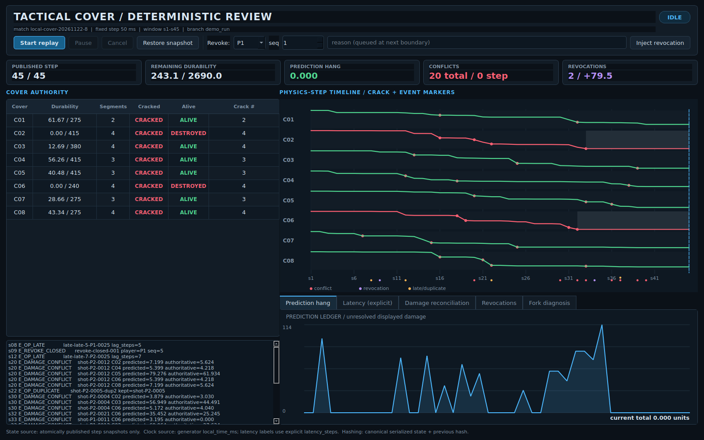
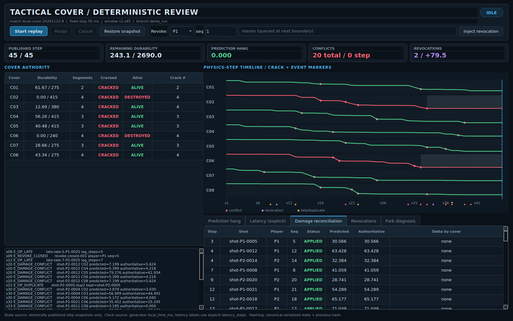

# 战术掩体确定性复核工作台

本地、可复现的掩体射击重放与对账工作台。项目只使用本地确定性样本，不连接真实账号或线上服务，不依赖系统时间、全局随机状态或容器环境。



## 已实现能力

- 固定物理步重放：按玩家缓存射击，按稳定次序在步边界结算。
- 弹丸损伤：命中矩形、入射角、动量、材料硬度、分段开裂阈值。
- 邻接扩散与连锁开裂：半径衰减、最大链路深度、确定性 BFS 顺序。
- 预测挂账对账：`APPLIED`、`REFUNDED`、`CONFLICT`。
- 每步守恒校验与 `E_DAMAGE_IMBALANCE`。
- 确定性状态哈希链：固定字段、整数微单位、canonical JSON、前序哈希。
- 撤回补偿：未结算撤回恢复挂账，已结算撤回返回 `E_REVOKE_CLOSED`。
- 迟到与重复：`E_OP_LATE`、`E_OP_DUPLICATE`，保留落后步数和重复计数。
- 原子快照：临时文件 + `fsync` + `os.replace`。
- 恢复校验：字段、连续性、哈希链、状态重算、缓冲水位。
- 单推进任务锁与 `E_BUSY`。
- 物理步边界协作式暂停/取消，最后已提交快照保持不变。
- PySide6 桌面工作台：时间轴、掩体表、挂账曲线、显式延迟分布、逐条对账、撤回列表、分叉诊断。
- 本地样本生成器：射击录像、初始状态、撤回注入、基线、manifest。

## 快速开始

要求 Python 3.11+。以下以 Windows PowerShell 为例：

```powershell
py -3.12 -m venv .venv
.\.venv\Scripts\python.exe -m pip install --upgrade pip
.\.venv\Scripts\python.exe -m pip install -e ".[test]"

.\.venv\Scripts\python.exe -m tactical_review generate `
  --out samples\demo --seed 20261122 --covers 8 --shots 48 --end-step 45

.\.venv\Scripts\python.exe -m tactical_review run `
  --sample samples\demo --run-dir artifacts\demo_run

.\.venv\Scripts\python.exe -m tactical_review gui `
  --sample samples\demo --run-dir artifacts\demo_run
```

在已安装依赖的 Linux/WSL 环境中：

```bash
python -m tactical_review generate --out samples/demo --seed 20261122 \
  --covers 8 --shots 48 --end-step 45
python -m tactical_review run --sample samples/demo --run-dir artifacts/demo_run
python -m tactical_review gui --sample samples/demo --run-dir artifacts/demo_run
```

图形界面必须在有显示会话的 Windows 桌面运行。无头验证使用：

```bash
QT_QPA_PLATFORM=offscreen python -m pytest -q
```

仓库已包含一次完整本地运行：

- `samples/demo/`：初始状态、53 条投递记录（含重复）、2 条撤回、基线、manifest。
- `artifacts/demo_run/`：45 个已发布步骤快照、`review_report.json`、`trajectory.jsonl`。

## 确定性语义

### 观测窗口与时间源

- 样本显式声明 `observation.start_step=1` 与 `observation.end_step`，结束步包含在窗口内。
- 每个物理步只发布一个快照：先处理本步到达事件，再执行结算屏障，最后计算哈希并原子发布。
- 结算时间来自 `step * step_ms`；射击本地时间来自样本生成器写入的 `local_time_ms`。
- 重放、哈希、对账和恢复均不读取 wall clock，不使用全局 `random`。
- 结算真值固定为 `initial_state.json` 的初始掩体快照，不读取运行中的外部状态。

### 稳定排序

同一物理步的到达操作按以下键处理：

```text
(arrival_seq, kind_rank, stable_id)
```

其中撤回在同序号时先于射击处理。所有到达操作处理完毕后进入结算屏障，待结算射击按以下键取出：

```text
(max(target_step, arrival_step), player_id, client_seq, record_id)
```

因此：

- 同一物理步内改变投递列表顺序或到达序号，不会改变结算顺序、损伤结果和开裂位置。
- 撤回与结算在同一步到达时，按声明规则统一在结算屏障前处理；已在前一步结算的目标返回 `E_REVOKE_CLOSED`。
- 重复键为 `(player_id, client_seq)`，只接受首个未因迟到被拒的有效投递。

### 损伤模型

命中点必须落在某块掩体的矩形内。入射角以表面法线为 0 度：

```text
effective_momentum = momentum * max(0, cos(incident_angle))
raw_direct = round(effective_momentum / hardness * 1_000_000)
```

内部耐久与损伤以整数微单位保存，避免浮点哈希漂移。累计损伤跨越新分段时形成一个开裂事件：

```text
segment = floor(cumulative_damage / segment_threshold)
alive   = remaining_durability > 0
```

扩散损伤从命中掩体出发，按距离排序做确定性 BFS：

```text
spread = round(source_damage * chain_decay * (1 - distance / spread_radius))
```

扩散只进入半径内的相邻掩体，最多 `max_chain_depth` 层；只有扩散量达到该掩体分段阈值时才继续下一层。已结算损伤按当前剩余耐久截断，因此过杀会计入对账冲突，但不会产生负耐久。

### 对账守恒

每个物理步发布逐掩体账本，满足：

```text
authority_remaining + cumulative_authoritative_damage = max_durability
display_remaining  = authority_remaining - pending_prediction
sum(authority_remaining) + total_applied_damage = initial_total_durability
```

预测在投递到达时进入 `pending`。结算时：

- 预测逐掩体等于实际损伤：`APPLIED`。
- 目标不存在或所有受影响掩体耐久已为零：`REFUNDED`，并记录 `E_NO_HIT` 或 `E_DAMAGE_REFUNDED`。
- 任一掩体预测值与权威值不同：`CONFLICT`，产生 `E_DAMAGE_CONFLICT`，同时保留预测值、权威值和微单位原值。

任意账本不符会产生 `E_DAMAGE_IMBALANCE`，带步号和掩体标识；总量不符使用 `cover_id=ALL`。

### 哈希链

每个快照的 `hash_payload` 只包含固定顺序的序列化内容：

```text
step
covers[cover_id, remaining, cracked, alive]
pending[cover_id, amount]
revocations[stable fields, before pending, after pending]
previous_hash
```

使用无空格 UTF-8 canonical JSON 计算 SHA-256。下一链路的前序哈希取上一链路哈希；快照同时保存完整链前缀和 `chain_prefix_digest`。恢复时从磁盘字段重建 payload，重新计算当前哈希，并检查：

- 步骤连续；
- 每个 `previous_hash` 连续；
- 当前状态重算哈希等于链尾；
- 快照内 `hash_payload` 等于重建 payload；
- 前缀摘要一致；
- 缓冲水位一致。

## 撤回、迟到与重复

样本生成器显式给出 `arrival_step`、`arrival_seq`、`target_step`、`latency_steps` 和 `clock_source`。工作台不根据缺失字段推断延迟。

- `arrival_step - target_step > compensation_window_steps`：拒绝并产生 `E_OP_LATE`，记录 `lag_steps`。
- 在补偿窗口内迟到：在到达步结算。
- 提前到达：进入缓冲，在 `target_step` 结算。
- 撤回命中尚在缓冲：移除原投递、扣回预测挂账、写入补偿记录和撤回前后完整挂账。
- 撤回已结算命中：`E_REVOKE_CLOSED`。
- 撤回找不到目标：`E_REVOKE_NOT_FOUND`。
- 重复投递：`E_OP_DUPLICATE`，累计 `duplicate_count`，不重复施加预测或损伤。

## 原子快照与恢复

快照文件为 `step_000001.json`、`step_000002.json` 等。发布过程：

1. 在目标目录创建临时文件；
2. 写入完整 JSON；
3. `flush` + `os.fsync`；
4. `os.replace` 原子改名；
5. 对目录执行 `fsync`（平台支持时）。

恢复扫描所有步骤，逐项验证后从最新步继续。恢复状态包含掩体、预测挂账、缓冲射击、已结算键、撤回、拒绝、重复计数和哈希链。恢复从 `state.step + 1` 继续，已提交步不会重放。

若字段缺失、链断裂、状态重算失败或前缀摘要不符，则中止并返回 `E_RECOVERY_INVALID`，详情含首个断链步。

强制终止进程不会写退出报告，也不承诺写退出报告。只能依赖最后已原子提交的快照恢复。

## 业务码

| 业务码 | 含义 |
| --- | --- |
| `E_DAMAGE_IMBALANCE` | 耐久、损伤或挂账不守恒 |
| `E_DAMAGE_CONFLICT` | 客户端预测与权威结算不一致 |
| `E_DAMAGE_REFUNDED` | 受影响掩体已无耐久，本次全部退回 |
| `E_NO_HIT` | 命中点不在任何掩体内 |
| `E_OP_LATE` | 迟到超过补偿窗口 |
| `E_OP_DUPLICATE` | 重复客户端序号 |
| `E_REVOKE_CLOSED` | 撤回目标已关闭结算或撤回超窗 |
| `E_REVOKE_NOT_FOUND` | 撤回目标不存在 |
| `E_RECOVERY_INVALID` | 快照字段或哈希链恢复失败 |
| `E_PROGRESS_INJECTED` | 输入参数注入的推进异常 |
| `E_RECOMPUTE_INJECTED` | 输入参数注入的基线重算异常 |
| `E_PROGRESS_INVALID` | 非连续物理步推进 |
| `E_BUSY` | 同一分支已有推进任务 |

## 命令行

### 样本生成

```bash
python -m tactical_review generate \
  --out samples/demo --seed 20261122 --covers 8 --shots 48 --end-step 45
```

输出：

- `initial_state.json`：掩体材料、耐久、阈值、扩散参数、观测窗口、真值来源。
- `shots.json`：射击流、到达序号、显式延迟字段。
- `revocations.json`：补偿窗口撤回和已结算撤回注入。
- `baseline.json`：逐步耐久、开裂、存活、哈希链。
- `manifest.json`：参数、异常目标计数和文件 SHA-256。

### 完整重放

```bash
python -m tactical_review run \
  --sample samples/demo \
  --run-dir artifacts/demo_run
```

生成快照、`review_report.json` 和逐行 `trajectory.jsonl`。非致命业务码不会让命令失败；守恒、恢复、基线或注入异常返回非零退出码。

### 暂停后恢复

```bash
python -m tactical_review run \
  --sample samples/demo --run-dir /tmp/demo-branch --max-steps 17
python -m tactical_review restore \
  --sample samples/demo --run-dir /tmp/demo-branch
```

第二条命令从第 17 步快照继续到第 45 步，不重复应用第 1-17 步。

### 异常注入

```bash
# 推进异常：第 9 步不发布新快照，保留第 8 步
python -m tactical_review run --sample samples/demo \
  --run-dir /tmp/progress-fault --progress-fault-step 9

# 重算异常：报告 E_RECOMPUTE_INJECTED
python -m tactical_review run --sample samples/demo \
  --run-dir /tmp/recompute-fault --recompute-fault-step 5

# 直接破坏一个快照，再恢复以触发 E_RECOVERY_INVALID
python -m tactical_review corrupt --run-dir /tmp/recovery-branch \
  --fault hash_break --step 20
python -m tactical_review restore --sample samples/demo \
  --run-dir /tmp/recovery-branch
```

也可用 `--recovery-fault missing_field|hash_break|durability_tamper|prefix_digest --recovery-fault-step N` 在读取时注入恢复异常。

## 桌面工作台

```bash
python -m tactical_review gui --sample samples/demo --run-dir artifacts/demo_run
```

- `Start replay`：清空当前分支已发布快照，从初始真值开始。
- `Pause / Resume`：在下一个物理步边界协作式暂停/继续。
- `Cancel`：在边界停止，保留最后已提交快照。
- `Restore snapshot`：验证链后从最新步继续。
- `Inject revocation`：把撤回命令排到下一物理步边界；界面只读取发布后的结果。
- 主时间轴：每块掩体耐久轨迹、开裂点、死亡段、冲突/撤回/迟到标记。
- `Prediction hang`：预测挂账曲线。
- `Latency (explicit)`：只使用样本的 `latency_steps`；字段缺失时明确显示“不推断”。
- `Damage reconciliation`：逐条显示预测、权威、状态和逐掩体差值。
- `Revocations`：撤回状态、业务码、恢复量与前后挂账 tooltip。
- `Fork diagnosis`：逐步骤比较当前链与基线，定位首个分歧及掩体差异。



## 本地验证结果

执行：

```bash
QT_QPA_PLATFORM=offscreen .venv/bin/python -m pytest -q
```

结果：

```text
......................                                                   [100%]
24 passed
```

覆盖项包括：

- 样本生成字节级确定性；
- 投递列表乱序和到达序号重排不改变哈希与开裂位置；
- 每步总量、逐掩体耐久、挂账守恒；
- 迟到、重复、撤回关闭、冲突业务码；
- 17 步快照后恢复，最终哈希链与完整重放完全一致；
- 缺失字段、链断裂、耐久篡改、前缀摘要篡改均定位到首个断链步；
- 同分支并发启动返回 `E_BUSY`；
- 暂停后不再发布新步，恢复后在下一物理步继续；
- 取消后快照不再增长且仍可读取；
- 推进和重算异常注入码；
- CLI 两次运行的最终哈希和 trajectory 字节一致；
- PySide6 offscreen 界面只从已发布快照渲染。

本仓库演示样本的实际结果：

```text
seed                     20261122
physics steps            45
final state hash         673457357510b3087eceaf80afe42e3b4e456e74329039419c7bb2bf9c8ce0c4
baseline final hash      same
initial durability       2690000000 micro-units
applied damage           2446896121 micro-units
remaining durability      243103879 micro-units
damage balance           true
baseline differences     0
E_DAMAGE_CONFLICT        20 records (prediction drift / capped overkill)
E_OP_LATE                2 records (lag 5 and 7 steps)
E_OP_DUPLICATE           2 records
E_REVOKE_CLOSED          1 record
accepted revocation      restore 79.548879 units
final covers             8 cracked, 6 alive
```

完整证据见：

- `samples/demo/baseline.json`
- `artifacts/demo_run/review_report.json`
- `artifacts/demo_run/trajectory.jsonl`
- `artifacts/demo_run/step_000001.json` ... `step_000045.json`

## 目录

```text
tactical_review/
  model.py       输入模型、固定点转换、canonical JSON
  physics.py     命中、分段损伤、半径扩散与链路
  simulation.py  步边界、稳定排序、对账、哈希链
  snapshot.py    原子发布、链校验、恢复、磁盘故障注入
  runner.py      单任务并发锁、暂停/取消、运行时撤回队列
  reporting.py   基线差异与复核报告
  samplegen.py   本地确定性样本生成器
  gui.py         PySide6 只读快照工作台
  cli.py         generate / run / restore / corrupt / gui
tests/           24 项自动化验证
samples/demo/    可复现本地样本
artifacts/demo_run/ 完整轨迹与快照
docs/            工作台截图
```

## 边界说明

- 单推进锁覆盖当前进程及同一 run-dir；跨机器仍需外部协调服务，本项目不模拟分布式仲裁。
- 哈希链用于检测磁盘损坏和未重算的篡改；若攻击者同时重算所有快照与基线，需要外部签名或受信锚点。
- 强制终止依赖操作系统已完成的原子提交；不保证终止时写退出报告。
- 图形界面的延迟只使用生成器显式字段，缺少 `latency_steps` 时不会用时间戳或步号猜测。
- 本项目不访问真实账号、线上服务或未授权目标。

